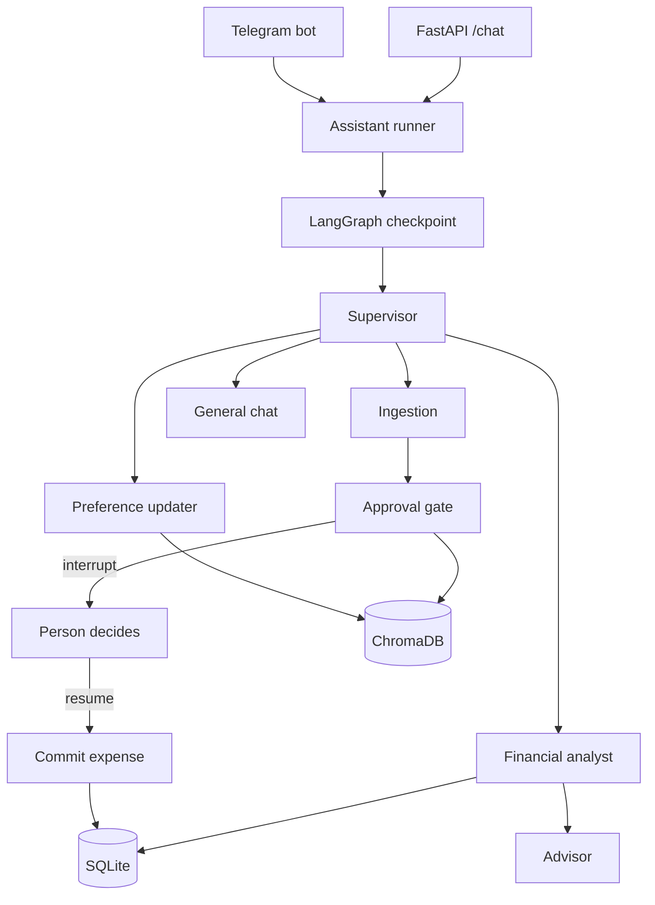

# Autonomous Expense Agent

A multi-agent assistant that records expenses, answers budget questions, and remembers categorization rules. You can talk to it over a FastAPI endpoint or a Telegram bot. Receipts arrive as text, a photo, or a PDF. Large, uncertain, or duplicate expenses pause for a person to approve, reject, or correct the category before anything is written to SQLite.

The assistant replies in Hebrew. Merchants, categories, and sample receipts are stored as UTF-8.

## Architecture



1. The supervisor classifies the latest message as an expense, a finance question, a standing preference, or general chat.
2. Ingestion reads a receipt image or PDF, or a sentence such as "שילמתי 40 ש״ח בשופרסל", and proposes a category. A matching rule in ChromaDB can override that category. A receipt hash catches duplicates.
3. The approval gate interrupts the graph when the amount is over 500 ILS, confidence is below 0.80, or the receipt looks like a duplicate. Nothing is inserted until the graph resumes.
4. The financial analyst may only run a single read-only `SELECT` scoped to that user. Anomaly flags are computed in Python from stored transactions.
5. The advisor turns those rows into a short Hebrew summary and a few next steps.
6. LangGraph stores each conversation in `data/checkpoints.sqlite3`, keyed by `thread_id`, so an approval can happen later on the same thread.

Telegram maps each `chat_id` to a `user_id` and a durable `thread_id` in the `conversation_threads` table. The first message from a chat also creates the user and the default Hebrew categories.

## Tech stack

| Piece | Choice |
| --- | --- |
| Language | Python 3.11+ |
| Orchestration | LangGraph with a SQLite checkpointer |
| API | FastAPI |
| Bot | python-telegram-bot (async, long polling) |
| Models | Gemini or a local Ollama model, selected with `LLM_PROVIDER` |
| Relational store | SQLite through SQLAlchemy 2.0 |
| Preference memory | ChromaDB |
| Validation | Pydantic v2 |
| Tracing | LangSmith, optional, via `LANGCHAIN_*` environment variables |

## Project layout

```text
app/
  agents/       Supervisor, ingestion, analyst, advisor, preferences
  graph/        State, workflow, checkpointer
  api/          FastAPI app and Telegram handlers
  db/           SQLAlchemy models, sessions, seed, Chroma client
  schemas/      Structured LLM output and HTTP payloads
  services/     LLM factory, receipt vision, read-only SQL, chat runner
data/           SQLite, Chroma, and checkpoints (created on first run)
tests/          Offline pytest suite. No network calls.
```

## Setup

```bash
python3.11 -m venv .venv
source .venv/bin/activate
pip install -r requirements.txt
cp .env.example .env
```

Seed six months of Hebrew demo expenses (this replaces previously seeded rows):

```bash
python -m app.db.seed
```

The command prints the demo `user_id`. Use that id with `/chat`. The demo Telegram id is `100000001`.

Run the full offline suite:

```bash
python -m pytest
```

## Environment variables

| Variable | Purpose |
| --- | --- |
| `DATABASE_URL` | SQLAlchemy URL. Relative SQLite paths resolve from the project root. |
| `CHROMA_PERSIST_DIR` | Directory for the `user_preferences` collection. |
| `LLM_PROVIDER` | `google` or `ollama`. |
| `LLM_MODEL` | Gemini model name when `LLM_PROVIDER=google`. |
| `GOOGLE_API_KEY` | Required for Gemini. Leave empty for Ollama. |
| `OLLAMA_BASE_URL` | Local Ollama server. Default `http://127.0.0.1:11434`. |
| `OLLAMA_MODEL` | Model used when `LLM_PROVIDER=ollama`. Kept separate so a Gemini name is not sent to Ollama. |
| `TELEGRAM_BOT_TOKEN` | Token from [@BotFather](https://t.me/BotFather). Required only to run the bot. |
| `LANGCHAIN_TRACING_V2` | `true` to send traces to LangSmith. Default `false`. |
| `LANGCHAIN_API_KEY` | LangSmith API key. Leave empty to stay local. |
| `LANGCHAIN_PROJECT` | LangSmith project name. |

The process loads `.env` when the API or the bot starts, so the `LANGCHAIN_*` names are visible to LangChain. Do not commit `.env`.

## Run with Gemini

Receipt photos and PDFs need a Gemini model that accepts images. The default is `gemini-3.8-flash`.

```bash
# .env
LLM_PROVIDER=google
LLM_MODEL=gemini-3.8-flash
GOOGLE_API_KEY=your-key
```

```bash
uvicorn app.api.main:app --reload
```

Health check:

```bash
curl -s http://127.0.0.1:8000/health
```

A healthy process returns `{"status":"ok","sqlite":"ok","chroma":"ok"}`. If either store is unreachable the status is `degraded` and the HTTP status is 503.

Text turn:

```bash
curl -s http://127.0.0.1:8000/chat \
  -H 'content-type: application/json' \
  -d '{"user_id":1,"thread_id":"demo-1","message":"שילמתי 40 ש״ח בשופרסל על לחם"}'
```

Receipt upload (multipart). `message` can be a caption; it can also be omitted when a file is attached.

```bash
curl -s http://127.0.0.1:8000/chat \
  -F user_id=1 \
  -F thread_id=demo-1 \
  -F message='קבלה מצורפת' \
  -F file=@receipt.png
```

A completed turn looks like:

```json
{"status":"completed","user_id":1,"thread_id":"demo-1","message":"שמרתי הוצאה של 40.00 ש״ח אצל שופרסל בקטגוריה סופר ומכולת.","pending_receipt":null,"interrupt":null}
```

An expense over 500 ILS, a low-confidence extraction, or a duplicate returns `"status":"interrupted"` plus `pending_receipt` and `interrupt`. The row is not in SQLite yet. Resume it on the same `thread_id`:

```bash
curl -s http://127.0.0.1:8000/chat/resume \
  -H 'content-type: application/json' \
  -d '{"user_id":1,"thread_id":"demo-1","approved":true,"category":"מסעדות ובתי קפה"}'
```

Set `"approved": false` to drop the expense. A different `category` is saved on the transaction and stored as a merchant rule in ChromaDB, so the next receipt from that merchant can reuse it. Sending another `/chat` message while the thread is paused returns 409. Resume it first.

`user_id` on resume must be the user who started the thread.

## Run with Ollama

Ollama stays on your machine. Receipt images still need a vision-capable model. The default local model is `llava`. A text-only model can handle typed expenses and budget questions, and will fail when a photo or PDF is attached.

```bash
ollama pull llava
```

```bash
# .env
LLM_PROVIDER=ollama
OLLAMA_BASE_URL=http://127.0.0.1:11434
OLLAMA_MODEL=llava
```

`LLM_MODEL` is ignored while the provider is `ollama`. Start the API with the same `uvicorn` command as above. Leave `GOOGLE_API_KEY` empty.

## Telegram

```bash
# .env
TELEGRAM_BOT_TOKEN=123456:your-bot-token
```

```bash
python -m app.api.telegram_bot
```

The bot long-polls Telegram.

- `/start` explains what to send.
- A text message can be an expense, a budget question, or a standing rule.
- A photo or a PDF is downloaded to a temporary file, passed into the graph as a receipt, and deleted after the turn.
- When the graph interrupts, the bot sends an inline keyboard: **Approve ✅**, **Reject ❌**, and one button per Hebrew category. The button label is the category name. The callback data is a short slug (`approve`, `reject`, or `cat:groceries`) so it stays inside Telegram's 64-byte limit.
- Pressing a button resumes the same checkpoint. A category button approves the expense and corrects the category.

Private chats use the Telegram user id as `users.telegram_id`. The stored thread id is `telegram-<chat_id>`.

## Example conversations

Typed expense under the approval threshold:

```text
את: שילמתי 40 ש״ח בשופרסל על לחם
בוט: שמרתי הוצאה של 40.00 ש״ח אצל שופרסל בקטגוריה סופר ומכולת.
```

Large expense, then a category correction:

```text
את: שילמתי 640 ש״ח בשופרסל
בוט: לאשר את שמירת ההוצאה?
     שופרסל: 640.00 ש״ח
     קטגוריה מוצעת: סופר ומכולת
     צריך אישור כי הסכום גבוה מ-500 ש״ח.
     [Approve ✅] [Reject ❌]
     [סופר ומכולת] [מסעדות ובתי קפה] ...
את: לוחצים על "מסעדות ובתי קפה"
בוט: שמרתי הוצאה של 640.00 ש״ח אצל שופרסל בקטגוריה מסעדות ובתי קפה.
     מעכשיו אסווג את שופרסל כמסעדות ובתי קפה.
```

Budget question:

```text
את: כמה הוצאתי על סופר החודש?
בוט: אין חריגה בולטת בהוצאות.

     מה כדאי לעשות:
     • המשיכו לעקוב אחרי הסופר
```

The wording of an analysis comes from the model. The figures come from SQLite. If a category is far above its recent average, the reply includes a "חריגות שזוהו" section.

Standing rule:

```text
את: תמיד תסווג את שופרסל כסופר ומכולת
בוט: שמרתי כלל: עסקאות של שופרסל יסווגו כסופר ומכולת.
```

Greeting:

```text
את: שלום, מה אתה יודע לעשות?
בוט: אפשר לשלוח קבלה, לתאר הוצאה, או לשאול על התקציב.
```

## Tests

`python -m pytest` runs offline. The suite stubs the chat model, uses temporary SQLite files, and uses a local hash embedder for ChromaDB. It covers receipt ingestion, routing, the approval interrupt, `/health`, `/chat`, `/chat/resume`, and the Telegram approve / reject / category keyboard.

## License

MIT. See [LICENSE](LICENSE).
